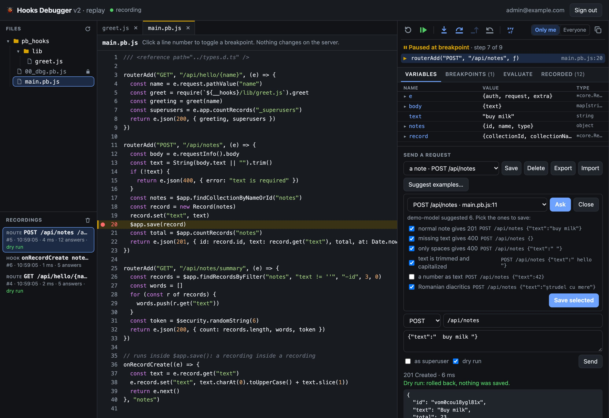
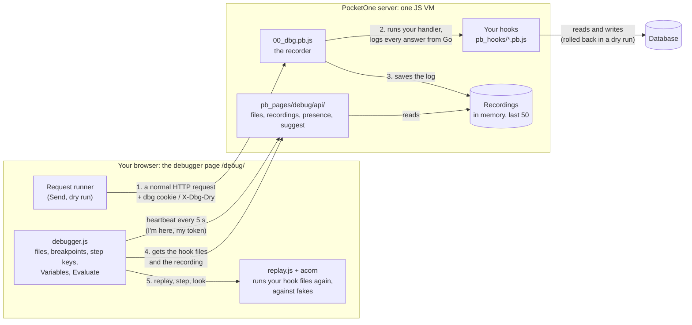
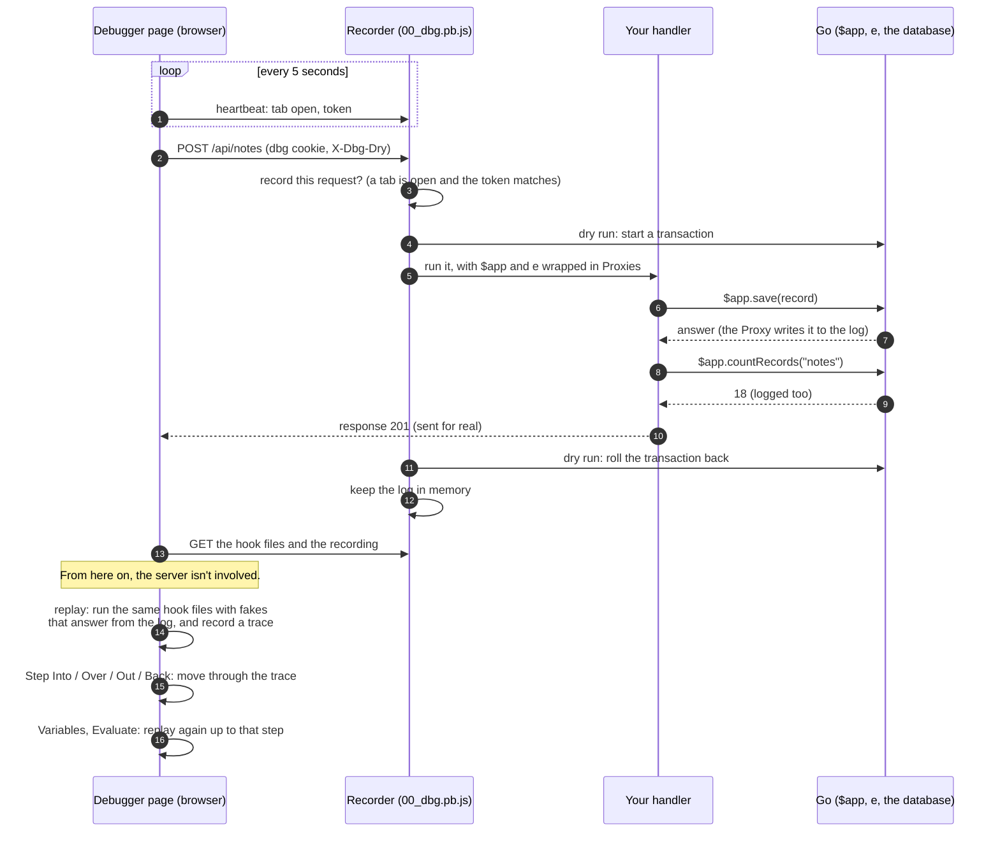

# PocketOne Hooks Debugger

A breakpoint debugger for the JS hooks (`pb_hooks`) of a [PocketOne](https://github.com/pocketonehq/pocketone) app.
A file tree, tabs, breakpoints on line numbers, a call stack, Variables / Breakpoints / Evaluate and a request
runner, like a debugger in an IDE. But **nothing is rewritten and nothing pauses on the server**: requests are
recorded, and the browser replays them, so you can also step back.



## How it works

1. **Record.** While a debugger tab is open, `pb_hooks/00_dbg.pb.js` records each run of a handler: every answer
   it gets from Go (`e`, `$app`, `Record`, `$security`, …, `Date.now()`, `Math.random()`), in order. With **dry
   run**, a route's handler runs inside a database transaction that is then rolled back, so nothing is saved.
2. **Replay.** You pick a recording. The browser runs the same hook files against fakes that give back exactly
   those answers, so the handler takes the same path through the code. Nothing reaches the server, so no write
   happens twice.
3. **Step.** The replay is instrumented in the browser, in memory, and gives its trace: every line it ran, with the
   call stack. Continue and Step Into / Over / Out move through the trace, and so does **Step Back**. To show the
   variables at a step, or evaluate an expression there, the replay runs again up to that step. That takes a few
   milliseconds, and the result is the same each time.

### The parts

The server records, the browser replays. They share nothing but the hook files and the recordings.



### One Send, step by step



## Features

- A file tree with subfolders, editor tabs with syntax highlighting, breakpoints on line numbers, a call stack (click
  a frame to see its variables), the Variables tree (`record`, `auth` and `request` first, secret headers masked),
  Evaluate in the selected frame, and a request runner.
- **Record for: Only me / Everyone** (top right). **Only me**, the default, records only your own requests: from the
  debugger's browser (a `dbg` cookie), with its `X-Dbg` header (the copy button next to it; for curl or an app on
  another origin), or from a superuser. **Everyone** records every handler run on the server. You need it for runs
  that can't carry your cookie or header: requests from other people or services (a mobile app, a webhook), and
  handlers without a request (`cronAdd` jobs, hooks not started by a request), unless they run inside a recorded
  request. On a server with real users, Everyone records their requests and data, so switch back when you're done.
- Idle mode: after 2 minutes without input the tab stops its heartbeats, so nothing is recorded and a hosted
  instance can hibernate.
- **Recordings** list: every handler run while the tab is open (routes, `on*()` hooks, cron jobs), with its file and
  line. A hook that runs inside another handler (e.g. `onRecordCreate` inside `$app.save()`) gets its own recording.
- **Dry run** (a checkbox next to Send, on by default): a `routerAdd` handler runs inside a database transaction
  that is rolled back at the end, so a POST, PATCH or DELETE changes nothing. You still get the response and a
  recording to step through. Sent as an `X-Dbg-Dry` header with the tab's token, so only you can ask for it (runs
  recorded through Everyone are never dry). Not undone: anything outside the database (`$http` calls, emails,
  files). Built-in routes (`/api/collections/…`) and `async` handlers
  aren't supported yet: the page says so, and an `async` handler isn't run at all.
- **Saved examples** of requests, above the request runner: **Save** the request (with a name, "as superuser" and
  "dry run"), pick one to fill in the form. Kept in this browser only (localStorage, like breakpoints): nothing is
  written to the server or the app folder. **Export** downloads them as `requests.json`, **Import** loads such a
  file (same names are replaced), so you can share them or keep them in git yourself.
- **Suggest examples…** (needs PocketOne's `$agent`, a language model set up in the dashboard under Settings → LLM,
  or in `pocketone.yaml`): pick a route, and the model reads its hook file (and the hook files it `require`s) and
  suggests example requests: the normal case, the error cases, edge cases. You see them first and save the ones
  you want; they're checked like an import and saved as dry runs. The panel says which model gets your code. The
  question runs in the background, so a slow model isn't cut off by PocketOne's 30 s limit for a request.
- **Only this server.** The request runner sends only to paths on this server (`/api/notes`, or a full address on
  this server). It refuses other sites (`https://…`, `//site/…`), a path without `/` (`www.site.de/…`),
  backslashes, spaces and control characters, so an imported file can't send your requests (or your superuser
  token) somewhere else. Imported examples with such a path are skipped.
- **Step Back** (Shift+F6) and **Replay from the start** (Shift+F8).
- **Recorded** tab: what Go answered during the run, highlighted up to the current step.
- **Async handlers and `$wasm`**: a promise from Go (e.g. `await $wasm.run.async("summary", input)`) is recorded
  with what it gave, or its error with the error's fields (a `WasmError`'s `code`, `retryable`, `module`). So you can
  stop on the line after the `await` and see the result in Variables. Frozen globals like `$wasm` are recorded too.
- At the end: **Finished: same as on the server** and the response, or what differs (e.g. the file changed since the
  recording).
- Your hook files are never changed, the hooks never restart, a pause has no time limit, and the debugger needs no
  collections or migrations.

## Quick start

1. Download PocketOne from its [releases](https://github.com/pocketonehq/pocketone/releases): the zip for your
   system, e.g. `pocketone_0.0.1-alpha.9_darwin_arm64.zip` (Mac with Apple silicon), `…_darwin_amd64.zip` (Intel Mac),
   `…_linux_amd64.zip` or `…_windows_amd64.zip`. Put it in this folder.
2. Unzip **only the binary**. The zip also has a `CHANGELOG.md`, which would overwrite this project's:

   ```sh
   unzip pocketone_0.0.1-alpha.9_darwin_amd64.zip pocketone      # pocketone.exe on Windows
   ```

   The binary, the zip and its other files are in `.gitignore`. On macOS, if you downloaded the zip with a browser
   and macOS refuses to open the binary, remove the download flag: `xattr -d com.apple.quarantine pocketone`.
3. Create a superuser and start the server. `pocketone.yaml` sets the port (8094) and the folders:

   ```sh
   ./pocketone superuser upsert you@example.com your-password
   ./pocketone serve
   ```

4. Open http://127.0.0.1:8094/debug/ and sign in with the superuser.
5. Open `main.pb.js` and click line 17. In **Send a request**, press **Send**. The request is recorded, and the
   replay stops at the line. F8 Continue · F5 Into · F6 Over · F7 Out · Shift+F6 Back · Shift+F8 Replay.

The demo app has `GET /api/hello/{name}` (with a helper in `lib/greet.js`), `POST /api/notes` (writes a record), and
`GET /api/notes/summary`, plus an `onRecordCreate` hook for `notes`.

### Adding it to an existing PocketOne app

You only need:

- `pb_hooks/00_dbg.pb.js`: the recorder. It must load before your other hook files (they load in name order), since
  it wraps the functions they register their handlers with.
- `pb_pages/debug/`: the debugger, served by PocketOne's PocketPages at `/debug/`. It needs nothing from your own
  `pb_pages` (no `+config.js`, auth plugin or layout changes): it signs superusers in with its own cookie
  (`dbg_auth`, HttpOnly, path `/debug`).

Remove both again to turn the debugger off completely.

## Files

| Path | What |
|---|---|
| `pb_hooks/00_dbg.pb.js` | The recorder. Wraps `routerAdd`, `cronAdd` and every `on*()`. Records only while a debugger tab sends heartbeats; with **Only me**, only requests with the tab's `dbg` cookie or `X-Dbg` header, or from a superuser. Keeps the last 50 recordings in memory and exposes them to the pages as `globalThis.__dbg` (pages run in the same JS VM). Runs a dry run in a transaction that is rolled back. |
| `pb_pages/debug/+middleware.js` | Superusers only (the `dbg_auth` cookie or an `Authorization` header), no layouts, `no-store`. |
| `pb_pages/debug/login/`, `logout/` | Sign in and out. |
| `pb_pages/debug/index.ejs` | The page. |
| `pb_pages/debug/api/files`, `recordings`, `presence` | JSON for the page: the hook files with their sources, the recordings, the heartbeat. |
| `pb_pages/debug/api/suggest` | Suggest examples: the routes, the model's status, and the question to `$agent` (in the background). |
| `pb_pages/debug/_private/replay.js` | The replay engine: the fakes, the instrumentation (acorn), the tracer, and the inspector for variables and Evaluate. |
| `pb_pages/debug/_private/debugger.js`, `debugger.css` | The UI. `index.ejs` writes these three files into the page, so only a signed-in superuser gets them (`_private/` is never served). |
| `pb_pages/debug/_private/acorn.js`, `acorn.LICENSE` | [acorn](https://github.com/acornjs/acorn) 8.19.0, the JavaScript parser the replay and the syntax highlighting use: `dist/acorn.js` from the npm package, unchanged, and its MIT license. Included so there's nothing to install and the debugger works offline. |
| `tests/engine.cjs` | Replays every recording of a running app in Node: `EMAIL=… PASSWORD=… node tests/engine.cjs`. Uses the same `acorn.js`, so there's nothing to install. |
| `tests/browsers.mjs` | Tests the whole flow in Chrome, Firefox or Safari on macOS, with real key presses: `BROWSER=chrome` (or `firefox`, `safari`) `EMAIL=… PASSWORD=… node tests/browsers.mjs`. Nothing to install: it uses the browser's built-in WebDriver (for Safari, turn it on once with `sudo safaridriver --enable`). It clears the recordings and creates a note, so use it on the demo app. |
| `pb_hooks/main.pb.js`, `pb_hooks/lib/greet.js`, `pb_migrations/` | The demo app. |

## Tested with

| | Version |
|---|---|
| PocketOne | **0.0.1-alpha.9** (PocketBase 0.42.3), the release binary for macOS (darwin/amd64) |
| Browsers | **Google Chrome 157** (157.0.8103.79, V8), **Firefox 145.0** (SpiderMonkey), **Safari 26.6.2** (JavaScriptCore), on macOS. The replay runs in the browser's JS engine, not in PocketOne's QuickJS |
| acorn | 8.19.0, included |
| Node | 24.22.1, for `tests/engine.cjs` |
| PocketHost | an instance on PocketHost's PocketOne (`X-Powered-By: Pocker 0.0.1-dev+7da9aa9f`), 2026-11-21, in Chrome: async routes with `$wasm` (Go, Rust and WAT modules, an error, a module's examples) recorded, paused after the `await`, and replayed "same as on the server" |

In each browser: sign-in, recording (also a hook inside a hook), replay "same as on the server", breakpoints, all
the step keys (F5, F6, F7, F8, Shift+F6, Shift+F8), Evaluate, a dry run, saved examples (save, import, delete; not Export's download), and the hook files named `pb_hooks/…` in the browser's
developer tools (`tests/browsers.mjs` in all three, plus a check by hand). On a Mac keyboard you may have to hold **fn** for the F keys.

PocketOne is still in alpha: a newer release can change what hooks see, so the recorder and the replay may need
updates.

## Limitations

- **PocketOne only.** The recorder relies on all hooks and pages sharing one JS VM, and the UI on PocketPages. For
  plain PocketBase (e.g. a PocketHost instance that doesn't run PocketOne) see
  [the earlier version](#earlier-version-plain-pocketbase).
- **CommonJS `.js` hook files only** for now (not `.pb.mjs` or `.pb.ts`). The replay runs in the browser's JS engine,
  not QuickJS. That rarely matters for hook code.
- **Go objects show a snapshot** taken when the handler first got them, e.g. a record before its `set()` calls.
- **Evaluate** runs in the browser. A Go method the handler called gives its recorded answer, which may be from later
  in the run (e.g. `record.get("text")` before `$app.save()` shows the value after the save hooks). Properties the
  handler never read come from the snapshot. Methods it never called aren't available.
- **Not recorded yet:** middlewares (`routerUse` and a route's own middlewares), and `new Date()` without arguments.
  The replay skips a route's middlewares: what top-level code gets from Go while the hook files load (e.g.
  `$apis.requireSuperuserAuth()` passed to `routerAdd`) is a stand-in that does nothing.
- **Go values inside your own objects** (e.g. `e.json(200, { out })`, where `out` came from Go) are shown by their
  path in the Recorded tab and the response, like `"out": "@$wasm.run.async(…).await"`, not by their content.
- **Async handlers:** other requests can run during an `await` and see the recorder's wrapped globals, so they may
  be recorded into the wrong run.
- **Dry run** works only for `routerAdd` handlers that aren't `async`: after an `await`, PocketOne gives `$app` back
  its real app, so the rest would write outside the transaction. A handler that isn't `async` but returns a promise
  isn't detected: what it does after its first `await` is saved.
- **Recordings live in memory**: a restart or a hooks reload (e.g. after you edit a hook file) clears them.
- Arrow functions with an expression body (`(e) => e.json(...)`) have no line to stop on.
- **Safari:** an error's stack trace (e.g. `new Error().stack` in Evaluate) has no file name for hook code, because
  Safari doesn't use `//# sourceURL` there. Web Inspector does show the files as `pb_hooks/…`.

## Security

A debugger has to see everything your hooks do, so here is what this one does, and how you can check it.

**Only superusers.** Everything under `/debug/` except the sign-in page needs a superuser (`+middleware.js`). The
debugger's code is in `pb_pages/debug/_private/`, which PocketPages never serves, and `index.ejs` writes it into
the page: someone who isn't signed in gets only the sign-in form. You can check:
`curl -i http://127.0.0.1:8094/debug/_private/replay.js` returns 404.

**The recorder** (`pb_hooks/00_dbg.pb.js`) wraps your handlers and the Go objects they use (`e`, `$app`, the other
`$` globals) and writes down every answer they give, including request headers, cookies, bodies and records. It:

- records only while a superuser's debugger tab is open (it sends a heartbeat; recording stops 90 s after the last
  one). With **Only me**, only that tab's requests and superusers' requests are recorded. With **Everyone**, every
  handler run is recorded, other people's requests too.
- keeps the last 50 recordings in memory only: nothing is written to disk or to the database, and a restart clears
  them.
- never sends anything anywhere: it doesn't use `$http`, `$os` or files. The recordings are in
  `globalThis.__dbg`, and the debugger's pages show them only to a signed-in superuser. (Your own hook and page code
  runs in the same JS VM, so it could read them too, like anything else there.)
- masks the `Authorization`, `Cookie` and `Set-Cookie` headers in the views. They stay in the recording, because the
  replay needs the same values.
- **masks secrets in the whole recording** before a page can see it: private keys in PEM (`-----BEGIN … PRIVATE
  KEY-----`) become `‹private key masked›`, and the values of environment variables whose names say they are secret
  (`…KEY`, `…SECRET`, `…TOKEN`, `…PASSWORD`, e.g. a master key your hooks read with `process.env`) become
  `‹NAME masked›`, wherever they appear: in answers, in the arguments of a call (e.g. the input of a `$wasm` call),
  in the event's snapshot. To know what to mask, it reads `process.env` when a recording ends. The replay then gets
  the mask instead of the value, so a handler that uses a secret can replay differently from the server from that
  step on.

**Suggest examples** is the only part that sends anything out, and only when you click **Ask**: it sends the
route's hook file and the hook files it requires (no recordings, no data) to the language model your app is set up
with in `$agent`. That is a model PocketOne runs on your machine, your own API key's provider, or your host's; the
panel names it before you ask. The answer is treated as untrusted: every example is checked like an import (paths
on this server only), shown as text, and saved only if you pick it.

**`eval` and `with`.** Security scanners flag them, so here is why they are there. The replay (`replay.js`) runs
**your own hook files, in your own browser**: it reads them from your server, adds the step probes in memory and
runs them with an indirect `eval`, inside `with` (that's how the hooks see the fake `$app`, `e` and the other
globals). Evaluate runs what you type, in the paused frame. Nothing in the replay sends requests: Go values answer
from the recording. `tests/engine.cjs` does the same in Node with `vm.runInThisContext`; it only connects to the URL
you give it (default `http://127.0.0.1:8094`) and reads the credentials from environment variables.

**acorn.** `pb_pages/debug/_private/acorn.js` is a copy of [acorn](https://github.com/acornjs/acorn) 8.19.0
(`dist/acorn.js` from the npm package, MIT, unchanged; its license is in `acorn.LICENSE`). Check that it's the
original:

```sh
curl -s https://cdn.jsdelivr.net/npm/acorn@8.19.0/dist/acorn.js | shasum -a 256
shasum -a 256 pb_pages/debug/_private/acorn.js
# both: b95392d79457d0357555c5ed3e56302d074b92dff119bcf3b44179500b10e9df
```

The page loads nothing from other sites.

Don't leave `00_dbg.pb.js` and `pb_pages/debug/` on a production app you aren't debugging.

## Earlier version (plain PocketBase)

This project started as [pb-hooks-debugger](https://github.com/octavonu/pb-hooks-debugger) (now archived), which runs
on any PocketBase with JS hooks, including PocketHost. It puts probes into your hook files (**Enable debug**) and
pauses the real request on the server with `sleep()`.

## License

[MIT](LICENSE)
